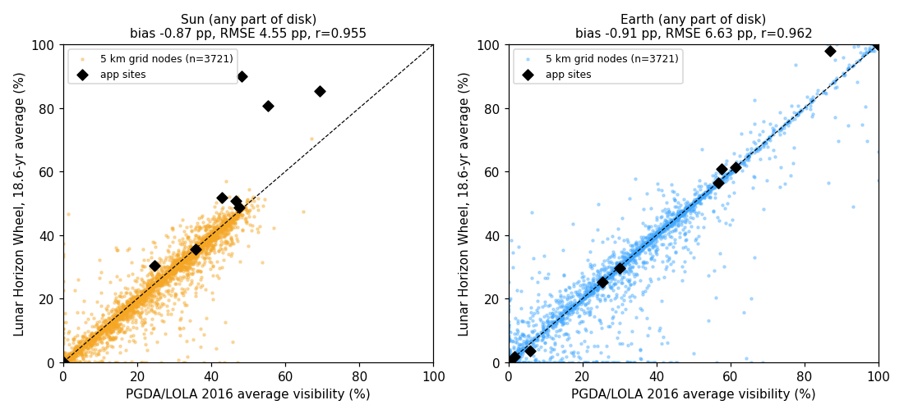

# Validation

_Generated by `make validate` (2026-10-13T12:41:37Z). All numbers are reproducible from `pipeline/validate.py`._

## A. Cross-validation against NASA Goddard / LOLA (PGDA) average-visibility maps

Reference products: LOLA GDR `AVGVISIB_65S_240M_201608` (Sun) and `AVGVISIB_65S_240M_201608_EARTH` (Earth), plus `AVGVISIB_85S_060M_201608` at sites; Mazarico et al. (2011) method, averaged over one 18.6-year lunar precession cycle; distributed via PGDA product 69 and the LOLA PDS node.
Our side: the same averaging window length (2026-01-01T00:00:00Z + 18.6 yr, 6 h step), our horizons + DE440 geometry. The PGDA label defines the value as the fraction of time steps with any part of the disk visible, so `sun_any` is the like-for-like metric; `sun_frac` (limb-darkened visible flux fraction) is shown for context.

Difference = ours − PGDA, in percentage points (pp) of time.

| Comparison | N | Bias (pp) | RMSE (pp) | MAE (pp) | 95% abs (pp) | Pearson r |
|---|---|---|---|---|---|---|
| Grid, Sun any-disk vs PGDA 240 m | 3721 | -0.87 | 4.55 | 2.17 | 8.78 | 0.955 |
| Grid, Sun flux fraction vs PGDA 240 m | 3721 | -2.35 | 5.12 | 3.09 | 10.04 | 0.953 |
| Grid, Earth any-disk vs PGDA 240 m | 3721 | -0.91 | 6.63 | 2.53 | 13.70 | 0.962 |
| Sites, Sun any-disk vs PGDA 240 m | 13 | +7.91 | 14.61 | 7.97 | 31.87 | 0.956 |
| Sites, Sun any-disk vs PGDA 60 m | 12 | +10.25 | 25.34 | 10.32 | 51.47 | 0.743 |
| Sites, Sun any-disk vs PGDA 60 m, max within 150 m | 12 | +1.23 | 3.54 | 1.93 | 7.14 | 0.997 |
| Sites, Earth any-disk vs PGDA 240 m | 13 | +0.90 | 3.30 | 1.37 | 6.45 | 0.997 |

### Per site (18.6-yr averages, %)

| Site | Ours Sun any | PGDA 240 m | PGDA 60 m | PGDA 60 m range within 150 m | Ours Sun flux | Ours Earth any | PGDA Earth 240 m |
|---|---|---|---|---|---|---|---|
| Shackleton (centre) | 0.0 | 0.0 | 0.0 | 0.0–0.0 | 0.0 | 0.0 | 0.0 |
| de Gerlache (centre) | 0.0 | 0.0 | 0.0 | 0.0–0.0 | 0.0 | 0.0 | 0.0 |
| Haworth (centre) | 0.0 | 0.0 | 0.0 | 0.0–0.0 | 0.0 | 3.6 | 5.8 |
| Faustini (centre) | 0.0 | 0.0 | 0.0 | 0.0–0.0 | 0.0 | 1.6 | 1.5 |
| Nobile (centre) | 35.4 | 35.8 | 35.8 | 35.5–35.8 | 34.3 | 29.5 | 30.0 |
| Mons Malapert (gazetteer centre) | 51.7 | 42.8 | 45.8 | 4.1–51.0 | 49.0 | 100.0 | 100.0 |
| Mons Mouton (gazetteer centre) | 30.5 | 24.5 | 25.6 | 21.4–34.2 | 27.4 | 60.8 | 57.4 |
| Shoemaker (centre) | 0.0 | 0.0 | 0.0 | 0.0–0.0 | 0.0 | 25.3 | 25.3 |
| Shackleton rim high point | 90.0 | 48.2 | 6.3 | 0.0–85.5 | 85.5 | 56.5 | 56.6 |
| de Gerlache rim high point | 85.4 | 69.3 | 82.7 | 38.3–82.7 | 82.0 | 61.2 | 61.4 |
| Mons Malapert summit (DEM max) | 80.7 | 55.4 | 55.6 | 42.2–70.3 | 77.6 | 98.1 | 86.9 |
| Mons Mouton summit (DEM max) | 50.7 | 46.6 | 49.6 | 33.9–50.1 | 49.6 | 100.0 | 99.8 |
| Shiv Shakti point (Chandrayaan-3) | 48.6 | 47.5 |  |  | 48.2 | 100.0 | 100.0 |

## B. Time sampling: ephemeris interpolation

The browser evaluates visibility every 10 minutes using Catmull-Rom interpolation of hourly DE440 vectors. Over 31 days (Mar 2027) at 10-min offsets, the maximum direction error vs direct SPICE is **1.91e-06 deg (Sun)** and **1.71e-06 deg (Earth)** (linear interpolation would give 1.21e-05 / 1.09e-04 deg). Both are far below the 0.5 deg horizon bin width.

## C. Grid (custom-site) horizons vs exhaustive site horizons

Custom sites use a precomputed 5 km grid of ray-marched 2-deg horizons. At the polar sites (grid footprint), ray-marched minus exhaustive (binned to 2 deg):

| Site | RMS (deg) | Bias (deg) |
|---|---|---|
| shackleton | 0.06 | -0.05 |
| de-gerlache | 0.61 | +0.29 |
| haworth | 0.84 | +0.32 |
| faustini | 0.06 | -0.05 |
| nobile | 0.22 | +0.03 |
| mons-malapert | 1.64 | +0.55 |
| mons-mouton | 0.43 | +0.03 |
| shoemaker | 0.08 | -0.04 |
| shackleton-rim-high | 0.27 | +0.05 |
| de-gerlache-rim-high | 0.18 | -0.04 |
| malapert-summit | 0.43 | +0.19 |
| mouton-summit | 0.36 | +0.07 |

## D. Sensitivity (calendar 2027)

Reference: 2-min step, limb-darkened finite disk, 40 m near-field DEM. Values are differences from the reference.

| Site | Ref sunlit % | 10 min | 60 min | point Sun | linear disk | uniform disk | 240 m DEM | Ref longest dark (h) | Δdark 60 min | Δdark 240 m DEM | Ref Earth % | ΔEarth 240 m DEM |
|---|---|---|---|---|---|---|---|---|---|---|---|---|
| Shackleton (centre) | 0.00 | +0.00 | +0.00 | +0.00 | +0.00 | +0.00 | +0.00 | 8760.0 | +0.00 | +0.00 | 0.00 | +0.00 |
| de Gerlache (centre) | 0.00 | +0.00 | +0.00 | +0.00 | +0.00 | +0.00 | +0.05 | 8760.0 | +0.00 | -3803.50 | 0.00 | +0.01 |
| Haworth (centre) | 0.00 | +0.00 | +0.00 | +0.00 | +0.00 | +0.00 | +0.00 | 8760.0 | +0.00 | +0.00 | 0.00 | +0.00 |
| Faustini (centre) | 0.00 | +0.00 | +0.00 | +0.00 | +0.00 | +0.00 | +0.00 | 8760.0 | +0.00 | +0.00 | 0.00 | +0.00 |
| Nobile (centre) | 34.32 | +0.00 | -0.00 | +0.01 | -0.00 | -0.00 | +0.11 | 515.9 | +0.07 | -0.43 | 20.72 | +0.19 |
| Mons Malapert (gazetteer centre) | 48.70 | +0.01 | -0.17 | -0.06 | +0.04 | +0.02 | +26.24 | 294.1 | -0.13 | -6.13 | 100.00 | +0.00 |
| Mons Mouton (gazetteer centre) | 26.74 | +0.00 | +0.00 | -0.13 | +0.04 | +0.01 | +2.21 | 628.4 | +0.57 | -136.93 | 55.24 | +2.34 |
| Shoemaker (centre) | 0.00 | +0.00 | +0.00 | +0.00 | +0.00 | +0.00 | +0.00 | 8760.0 | +0.00 | +0.00 | 16.66 | -0.35 |
| Shackleton rim high point | 86.14 | +0.00 | -0.02 | +0.19 | -0.08 | -0.02 | -1.06 | 70.0 | -0.03 | +2.80 | 49.51 | -0.08 |
| de Gerlache rim high point | 83.01 | +0.00 | +0.01 | +0.06 | -0.00 | +0.00 | +1.16 | 269.7 | +0.30 | -120.37 | 54.74 | -0.05 |
| Mons Malapert summit (DEM max) | 78.31 | +0.00 | -0.00 | -0.02 | -0.02 | -0.00 | +4.31 | 265.9 | +5.07 | -1.43 | 81.35 | +18.65 |
| Mons Mouton summit (DEM max) | 48.29 | +0.00 | +0.00 | +0.02 | -0.01 | -0.00 | +2.41 | 409.9 | +0.07 | -152.60 | 100.00 | -0.51 |
| Shiv Shakti point (Chandrayaan-3) | 46.82 | +0.00 | -0.01 | +0.02 | -0.00 | -0.00 | +0.00 | 382.4 | +0.60 | -0.07 | 100.00 | +0.00 |

Shiv Shakti (69.37 S) lies outside the 40 m DEM, so its DEM-resolution term is not estimable (shown as +0.00) and is flagged in the app. It is also outside the PGDA 65S maps, so it has no external illumination check.

Interpretation: time step and Sun-disk model contribute well under 1 pp; DEM resolution of the near-field horizon dominates the uncertainty, which is why the app shows the 40 m vs 240 m spread as its error bar.
